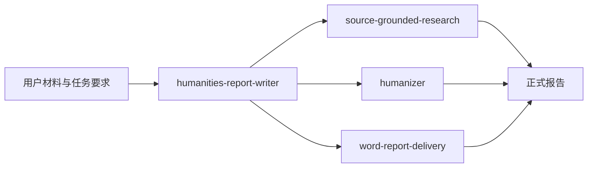

# Humanities Report Writing Suite

一套面向中文人文社科报告的通用 Agent Skills。它可以把问卷、访谈、案例、政策、文本、史料和社会实践材料整理成正式报告，并在需要时完成联网核验、中文自然化和 Word 交付。

项目主要服务不熟悉研究方法和复杂提示词的使用者。用户只需提供材料、用途和格式要求，主 Skill 会负责审读文件、建立事实底表、选择结构并调用依赖。

## 包含的 Skill

| Skill | 作用 | 来源 |
|---|---|---|
| `humanities-report-writer` | 审读材料、控制事实边界、选择报告结构并统筹写作 | 本项目 |
| `source-grounded-research` | 学习优秀范例，核验政策、时效性事实、文献和外部来源 | 本项目 |
| `word-report-delivery` | 创建或套用 Word 模板，完成样式、编号、目录、题注和逐页检查 | 本项目 |
| `humanizer` | 在终稿阶段减少机械表达和常见 AI 写作痕迹 | 第三方开源依赖 |



## 下载与安装

普通使用者建议从 [Releases](https://github.com/xuedai-mayi/humanities-report-writing-suite/releases) 下载最新安装包和极简说明书。

把安装包交给支持 Skill 的 AI，然后复制：

```text
请先检查这个压缩包的全部内容，不运行任何脚本。按照 INSTALL.md，把 skills 目录下的四个 Skill 安装到当前 AI 的用户级技能目录。遇到同名 Skill 不要覆盖，先比较并告诉我。安装后逐个验证，完成只读测试，并报告安装路径、已加载项目、冲突和失败项目。
```

也可以克隆仓库，再把 `skills` 目录下的四个文件夹分别复制到当前 AI 的用户级 Skill 目录：

```bash
gh repo clone xuedai-mayi/humanities-report-writing-suite
```

不同 AI 的技能目录和重新加载方式可能不同。完整步骤见 [INSTALL.md](INSTALL.md)，一页式中文说明见 [极简说明书](docs/通用人文社科报告写作Skill_极简说明书.docx)。

## 使用方法

安装后可以直接说：

```text
请使用 humanities-report-writer。材料在这里：[文件夹或附件]。用途是：[课程、评选、结项或其他]。请先读完材料，能找到的不要问我；缺失问题一次问完。最后生成可以提交的 Word，不要编造事实、数字、日期、活动、引文和文献。
```

主 Skill 在下列情况下会强制调用依赖：

- 生成、改写或审阅中文自然语言时，使用完整 `humanizer` 并以 embedded mode 完成终稿处理。
- 需要联网学习范例、核验最新事实、查政策或文献时，使用 `source-grounded-research`。
- 需要 `.docx`、套用 Word 模板或检查正式排版时，使用 `word-report-delivery`。

如果环境缺少必需依赖，主 Skill 会停止相应交付并提示安装，不会用几条摘要规则冒充完整能力。

## 第三方开源依赖

本仓库嵌入了 [blader/humanizer](https://github.com/blader/humanizer) 的完整 `humanizer` Skill：

- 原作者：Siqi Chen
- 随包版本：2.9.1
- 上游提交：`523374dee72d67c7b2b5f858ea0094ffda49c3ac`
- 许可证：MIT License
- 随包文件与该提交中的对应文件一致，没有删减或改写

原版权声明保存在 [`skills/humanizer/LICENSE`](skills/humanizer/LICENSE)，文件哈希和详细说明见 [NOTICE.md](NOTICE.md)。其余三个 Skill、安装文档和模板由本项目编写。

## 事实与安全边界

- 不虚构姓名、单位、数字、日期、活动、访谈原话、文献和链接。
- 不把相关关系写成因果关系，不把非概率样本外推为全部公众。
- 原始材料默认只读。没有用户授权时，不覆盖原文件。
- 安装包不含可执行脚本。接收方 AI 应先检查文件，再复制 Skill。
- 任何 AI 生成的正式报告仍需使用者核对身份信息、数字、引用和公开范围。

## 贡献与安全问题

提交问题或改进前请阅读 [CONTRIBUTING.md](CONTRIBUTING.md)。安全问题不要放在公开 Issue 中，请按照 [SECURITY.md](SECURITY.md) 使用 GitHub 的私密漏洞报告功能。

## 许可证

本项目编写的内容采用 [MIT License](LICENSE)。第三方 `humanizer` 同样采用 MIT License，但保留其独立的原作者版权声明和许可文件。
